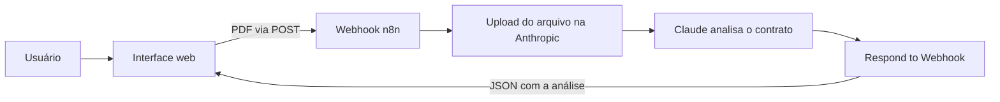

# JARVIS AI — Análise inteligente de contratos

O **JARVIS AI** é um protótipo que recebe contratos em PDF e utiliza inteligência artificial para produzir uma análise organizada do documento.

O projeto combina uma interface web (HTML, CSS e JavaScript), um workflow de automação no **n8n** e a API **Anthropic Claude**.

## Funcionalidades
- Envio de contratos em PDF.
- Recebimento do arquivo por webhook.
- Processamento do documento pelo workflow n8n integrado ao Claude.
- Exibição da análise na interface.
- Cópia da análise e download em TXT.

A análise pode abordar resumo, partes envolvidas, valores, pagamentos, multas, prazos, obrigações, cláusulas de atenção e conclusão.

> **Aviso:** a análise é gerada por IA, pode conter erros e não substitui orientação jurídica.

## Arquitetura



## Estrutura

```text
JARVIS-AI/
├── frontend/
│   ├── index.html
│   └── iniciar-servidor.bat
├── n8n/
│   └── INSTRUCOES-EXPORTACAO.md
├── docs/
│   ├── arquitetura.md
│   └── manual-de-uso.md
├── .gitignore
└── README.md
```

## Como executar localmente

Requisitos: Windows (ou Linux/macOS) e Python 3 instalado.

**Windows:** abra `frontend` e dê dois cliques em `iniciar-servidor.bat`. Depois acesse http://localhost:5500.

**Alternativa pelo terminal:** dentro da pasta `frontend`, execute:

```bash
python -m http.server 5500
```

Depois acesse http://localhost:5500. No Linux/macOS, use `python3 -m http.server 5500`.

## Conectar ao n8n

No arquivo `frontend/index.html`, procure a constante `WEBHOOK_URL`.

- Teste: use a URL `/webhook-test/analisar-contrato` e deixe o Webhook aguardando uma chamada de teste.
- Apresentação/uso normal: ative o workflow e use a URL `/webhook/analisar-contrato`.

A interface envia o PDF via `multipart/form-data`, no campo `contrato`. O Webhook deve receber esse campo binário. O nó `Respond to Webhook` deve devolver:

```json
{
  "analise": "Texto da análise produzida pelo agente"
}
```

Se o navegador bloquear a requisição, verifique CORS no ambiente n8n/proxy.

## Workflow n8n

O workflow roda na instância n8n, não dentro do servidor local da interface. Exporte o workflow real pelo n8n e salve o JSON em `n8n/jarvis-workflow.json`. Siga `n8n/INSTRUCOES-EXPORTACAO.md`.

## Segurança
- Não coloque chave da Anthropic, tokens ou senhas no HTML ou no GitHub.
- Mantenha credenciais no gerenciador de credenciais do n8n.
- Use documentos fictícios ou autorizados nas demonstrações.
- Não publique contratos com dados pessoais ou confidenciais.

## Tecnologias
HTML, CSS, JavaScript, n8n, Anthropic Claude API e Webhook HTTP.

**Projeto acadêmico — JARVIS AI.**
